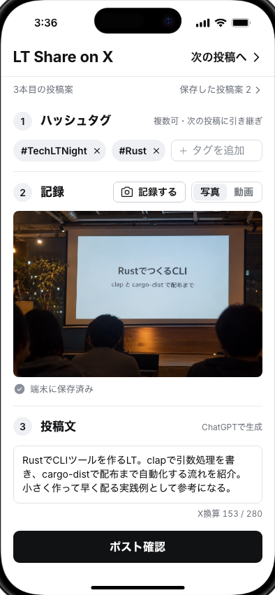
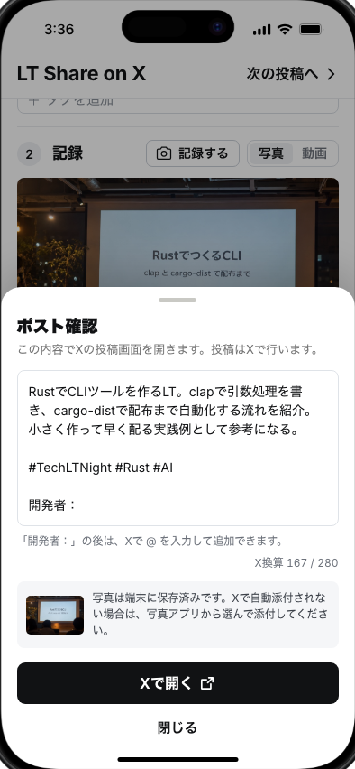
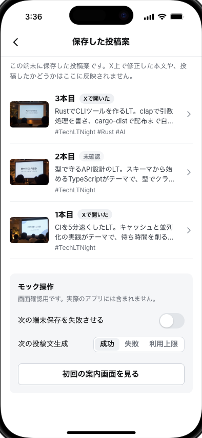

# LT Share on X

Share each lightning talk to X in a few taps while you keep listening.

LT Share on X is a planned mobile web app for attendees of developer lightning-talk events. Set the event hashtags once, record a photo or video of the talk, get a ~100-character Japanese summary written with your own ChatGPT plan, and hand the text off to X. The hashtags carry over to the next talk.

> **Status:** requirements and a clickable **screen mock** only. Camera, on-device storage, ChatGPT and X are simulated. Nothing has been verified on a real device or published.

<p>
  
  
  
</p>

## Repository layout

| Path | Contents |
| --- | --- |
| [`docs/requirements.md`](docs/requirements.md) | Requirements definition LT-SRS-001 v1.0 (Japanese) |
| [`docs/DESIGN.md`](docs/DESIGN.md) | Screen design record: concepts, selection, screens/states mapped to requirement IDs (Japanese) |
| [`docs/design/`](docs/design/) | Generated design concepts and screenshots of the mock |
| [`mock/`](mock/) | Clickable mobile screen mock (React + Vite, Product Design `mobile-app` template). It builds the static output OpenAI Sites expects; it has not been deployed. |

## Run the mock

Requires Node.js 22.18 or later.

```bash
cd mock
npm ci
npm run dev
```

Open the printed local URL. Use the device picker in the top-right corner to switch between iPhone and Pixel 10. Error states (failed save, AI failure, usage limit) can be triggered from "モック操作" at the bottom of the "保存した投稿案" screen.

## Checks

```bash
cd mock
npm run test:unit      # draft state, hashtag parsing, X weighted length
npm run check:runtime  # protected mobile runtime integrity
npm run build          # static client + Sites worker output in dist/
npm run test:sites     # Sites worker contract
npm run qa:capture     # screenshots of every main state (needs `npm run dev`; set MOCK_URL)
```

## Planned architecture (not implemented)

- Hosted on OpenAI Sites; no custom backend or server database.
- Text generation runs on the user's own ChatGPT plan with a lightweight OpenAI model.
- Photos, videos and drafts stay on the user's device. Posting always happens in X by the user.

See the requirements for the open feasibility checks (G-01 to G-03).
